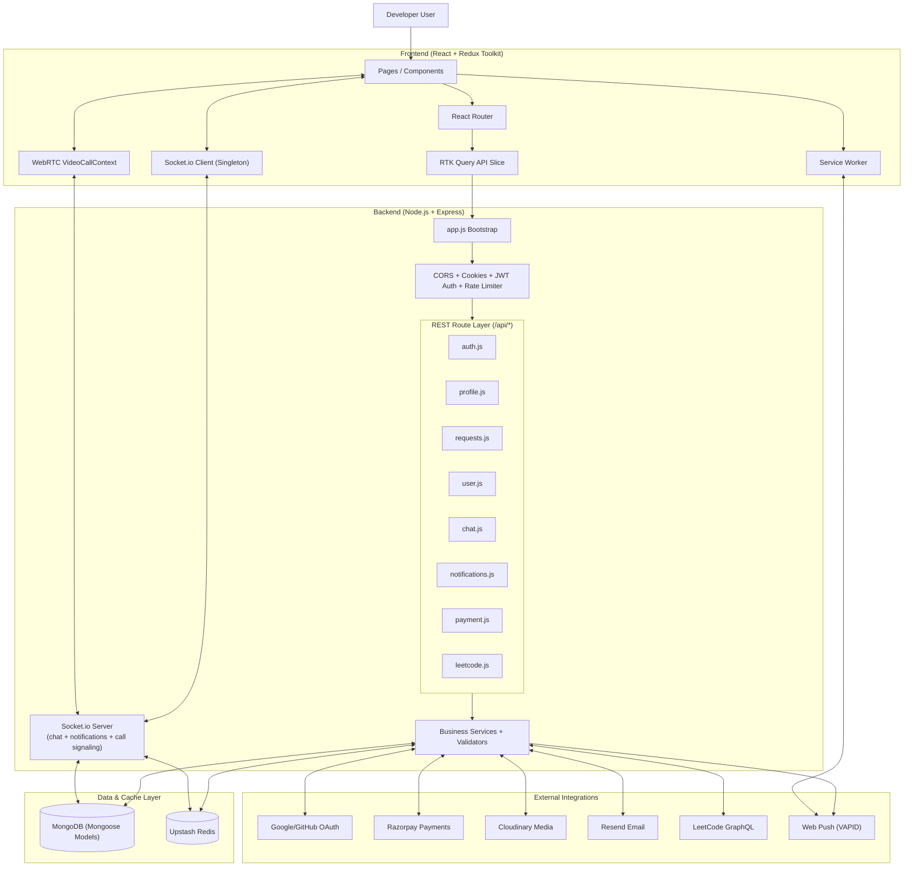
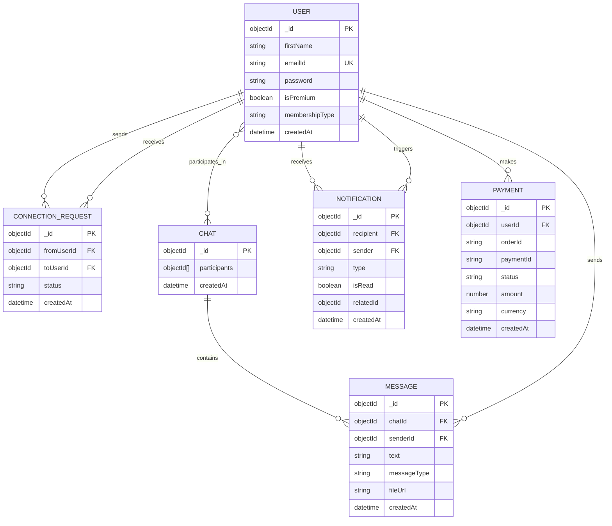

# devMatch 🚀 — The Premium Developer Networking Hub

[](https://opensource.org/licenses/MIT)
[](https://reactjs.org/)
[](https://nodejs.org/)
[](https://www.mongodb.com/)
[](https://tailwindcss.com/)
[](https://socket.io/)
[](https://webrtc.org/)
[](https://redis.io/)
[](https://cloudinary.com/)
[](https://vercel.com/)
[](https://render.com/)

**devMatch** is a next-generation professional networking platform engineered specifically for the developer community. By merging the intuitive "match-to-discover" user experience with verifiable technical credentials (GitHub/LeetCode integration), devMatch provides a high-fidelity environment for finding co-founders, collaborators, and mentors.

---

### 🧱 Core Architecture & Tech Rationale

| Layer | Technology | Key Purpose in devMatch |
| :--- | :--- | :--- |
| **Frontend** | **React v19 + RTK Query** | Delivers a high-performance SPA with automatic cache management for infinite-scrolling chat and discovery feeds. |
| **Forms** | **React Hook Form** | Performant, validation-rich form management with minimal re-renders across all auth and profile forms. |
| **Styling** | **Tailwind CSS v4 + DaisyUI** | A custom glassmorphic design system tailored for the "Elite Developer" aesthetic. |
| **Video/Audio** | **WebRTC (simple-peer-light)** | Browser-native peer-to-peer video and audio calling with Socket.io signaling relay. |
| **Real-time** | **Socket.io + Redux Slices** | Powers sub-50ms messaging delivery and instant global notification toasts. |
| **Backend** | **Node.js (type: module)** | A modern, asynchronous event-driven core capable of handling high-concurrency connections. |
| **Persistence** | **MongoDB + Mongoose** | Flexible, document-based storage designed for fast iteration on developer profiles. |
| **Speed/Security**| **Upstash Redis** | Provides lightning-fast session caching, OTP throttling, and global rate limiting. |
| **Identity** | **Passport.js (OAuth 2.0)** | Seamless integration with GitHub and Google for frictionless onboarding. |
| **Media** | **Cloudinary (Signed Uploads)** | High-optimized media pipeline allowing the frontend to upload directly via secure signatures. |

---

## ✨ Key Features

### 📡 Real-Time Professional Networking
- **Algorithmic Discovery (Feed)**: A Tinder-inspired discovery engine where developers can view profiles, tech stacks, and "Pass" or "Connect" in one click.
- **Dynamic User Cards**: Rich profile visualizations featuring bios, tech expertise, and professional experience.
- **Bi-Directional Request Management**: Active "Incoming" and "Outgoing" tabs to manage both received invitations and pending sent requests.
- **Request Withdrawal**: Instant "Unsend" capability for pending invitations to maintain discovery control.
- **Optimized Pagination**: High-performance data segmentation for Feed, Connections, and Request lists to ensure smooth scaling.

### 🏆 Master Portfolio & Technical CV
- **Dedicated Professional Identity**: Independent `/portfolio` route providing a high-impact, full-screen technical CV.
- **Real-Time Activity Pulse**: Integrated **GitHub** and **LeetCode** activity heatmaps (contribution calendars) for instant technical proof.
- **Custom GraphQL Proxy**: High-performance backend proxy (`/api/leetcode`) to fetch LeetCode data securely and bypass CORS restrictions.
- **Dynamic Identity Linking**: Automated social reels for LinkedIn, LeetCode, GitHub, and Personal Portfolios that update in real-time.
- **Professional Headline Engine**: Dynamic role-based headlines (e.g., "Frontend Architect", "Cloud Engineer") that sync across the global feed and CV.
- **Aesthetic Branding**: Premium glassmorphic design system using the "Elite Developer" dark-mode palette.

### 💬 Real-Time Communication (High-Performance Engine)
- **WhatsApp-Style Optimistic UI**: Messages appear instantly (under 50ms) in the sender's UI. The system reconciles the local state with the server via Socket.io acknowledgments.
- **Reverse Infinite Scroll**: High-performance "load-more" logic for legacy messages using a "Sentinel" Observer. 
- **Cursor-Based Pagination**: Uses `_id` cursors to fetch 20 messages at a time, ensuring the initial chat load is always < 200ms regardless of history size.
- **Persistent Message Store**: De-embedded collection architecture for messages to bypass MongoDB's 16MB document limit and ensure infinite scalability.
- **Visual Status Tracking**: Real-time "Pending", "Sent", and "Error" indicators for every message.
- **Rich Media Support**: Integrated image messaging with direct-to-cloud signed uploads.
- **Device Camera Integration**: Supports standard media picker for instant photo sharing and gallery selection.
- **Direct-to-Cloud Architecture**: Frontend uploads media directly to Cloudinary using secure backend signatures, bypassing the main server for massive scalability.

### 📞 Real-Time Video & Audio Calling (WebRTC)
- **Dual Call Modes**: Separate **Video Call** and **Audio Call** buttons — audio calls request microphone only (no camera activation), video calls request both.
- **Peer-to-Peer Architecture**: Uses **simple-peer-light** (browser-native WebRTC) for direct media streaming between users with zero server relay overhead.
- **Socket.io Signaling Server**: Backend relays SDP offers/answers and ICE candidates via personal user rooms for reliable call setup.
- **Call Timeout**: Outgoing calls automatically disconnect after 20 seconds if the recipient doesn't answer, preventing ghost calls.
- **Full-Screen Call Portal**: Immersive UI with picture-in-picture local video (video calls), large avatar display (audio calls), and glassmorphic controls.
- **In-Call Controls**: Mute/unmute microphone, toggle camera on/off (video calls only), and one-tap hang-up.
- **Busy Detection**: Incoming calls are auto-rejected if the user is already in an active session.
- **Error Recovery**: Peer connection failures automatically notify the remote user and clean up all media resources.

### 👑 Premium Membership (Monetization)
- **Tiered Plans**: Silver and Gold membership tiers with exclusive benefits.
- **Razorpay Integration**: Fully functional, secure payment gateway for membership upgrades.
- **Elite Badges**: Visual premium indicators for verified power users.

### 🔔 Real-Time Notification System (Multi-Channel)
- **Global Toast Alerts**: Instant, glassmorphic in-app notifications with sender avatars for connection requests, acceptances, and messages.
- **Real-Time Audio Feedback**: Curated "Ping" sound effects for immediate sensory feedback on new alerts.
- **Background Web Push (W3C Standard)**: Integrated Service Worker and VAPID-based push notifications that work even when the browser tab is closed.
- **Notification Center**: Integrated Navbar Bell with a dynamic unread badge count and a historical alert dropdown.
- **Intelligent Bundling**: Automated message consolidation ensures users aren't spammed with multiple alerts from the same sender in a short window.
- **Singleton Socket Manager**: Re-engineered frontend socket architecture to provide a single, app-wide persistent connection for both chat and global notifications.

### 🔐 Security & Reliability
- **Multi-Layered Rate Limiting**: Redis-backed protection against DDoS, brute-force (Auth), and email spam (OTP).
- **Resend SDK Integration**: Scalable, high-performance email delivery using the Resend SDK (HTTP-based) for maximum reliability in cloud environments.
- **Auto-Triggered Login OTP**: Smart authentication flow that automatically sends a fresh OTP if an unverified user attempts to log in.
- **Secure Password Recovery**: Expirable reset links handled via Redis for maximum security.
- **CORS Protection**: Strict cross-origin resource sharing policies.
- **Session-Based Auth**: Secure authentication using cookies (`withCredentials: true`).
- **Validation Layers**: Robust client-side and server-side input validation for all critical payloads.
- **Cloudinary Integration**: Fully automated, high-performance cloud storage for developer profile photos and chat media.
- **Smart Image Compression**: Client-side optimization using `browser-image-compression` (< 500KB) for both profile photos and chat attachments to ensure ultra-fast uploads.
- **Social OAuth 2.0 Integration**: One-click registration and login via Google and GitHub, powered by Passport.js.
- **Smart Account Linking**: Automatically merges social logins with existing accounts if the email addresses match.
- **Cross-Domain Token Exchange**: Production-safe OAuth flow using a dedicated token exchange endpoint, solving third-party cookie restrictions between Vercel and Render.


---

## 🛠️ Technology Stack

### Frontend
- **Framework**: React.js (v19)
- **Performance**: Route-based **Lazy Loading** (Code Splitting) and **Suspense** for instant initial bundles.
- **State Management**: Redux Toolkit & RTK Query (with custom cache merging for infinite scroll).
- **Forms**: React Hook Form (Performant, validation-rich form management with minimal re-renders).
- **Styling**: Tailwind CSS v4 & DaisyUI (Custom Premium Theme).
- **Video/Audio Calling**: WebRTC via simple-peer-light (browser-native, no Node.js polyfills required).
- **Asset Optimization**: Immutable caching and production-grade routing via `vercel.json`.
- **HTTP Client**: Axios (Interceptors for credentials).
- **Image Processing**: browser-image-compression (Smart max 300KB client-side optimization).

### Backend
- **Engine**: Node.js & Express.js
- **Database**: MongoDB (Mongoose ODM)
- **Cache & Security**: Upstash Redis (OTP storage & Speed-limiting)
- **Real-Time**: Socket.io (Namespaced rooms for individual chats & WebRTC signaling relay)
- **Email**: Resend (HTTP SDK for transactional delivery)
- **Verified Domain**: `support.akashtech.in` (Professional branding)
- **Authentication**: JWT, Cookie-Parser, and Passport.js (Google & GitHub Strategies)
- **Payments**: Razorpay Node SDK
- **Cloud Storage**: Cloudinary (Image management & transformations)
- **File Uploads**: Multer (Memory-buffer optimized processing)


---

## 📁 System Architecture

### High-Level System Architecture (Mermaid)


### Database Schema (Mermaid ER Diagram)


### Backend Directory Structure
```bash
backend/
├── src/
│   ├── app.js                      # Main entry point — Express app, startup pipeline & server bootstrap
│   ├── config/
│   │   ├── cloudinary.js           # Cloudinary SDK initialization (v2)
│   │   ├── cookieConfig.js         # Shared secure cookie options (httpOnly, sameSite, maxAge)
│   │   ├── database.js             # MongoDB connection via Mongoose
│   │   ├── env.js                  # Loads and validates environment variables via dotenv
│   │   ├── passport.js             # Passport.js strategies — Google OAuth 2.0 & GitHub OAuth
│   │   ├── rateLimiter.js          # Factory functions for Redis-backed rate limiters (global / auth / OTP)
│   │   └── redis.js                # Upstash Redis client initialization & connection helper
│   ├── middlewares/
│   │   ├── auth.js                 # JWT cookie verification middleware — attaches user to req
│   │   └── multer.js               # Multer memory-buffer configuration for file uploads
│   ├── models/
│   │   ├── chat.js                 # Chat & Message schemas (de-embedded for infinite scalability)
│   │   ├── connRequest.js          # ConnectionRequest schema (interested / ignored / accepted / rejected)
│   │   ├── notification.js         # Notification schema (NEW_MESSAGE / CONNECTION_REQUEST / REQUEST_ACCEPTED)
│   │   ├── payment.js              # Payment schema — Razorpay order & verification records
│   │   └── user.js                 # User schema — profile, skills, OAuth IDs, membership, push subscriptions
│   ├── routes/
│   │   ├── auth.js                 # Auth routes — signup, login, OTP, password reset, OAuth, token exchange
│   │   ├── chat.js                 # Chat routes — message history (cursor pagination) & signed media upload
│   │   ├── leetcode.js             # GraphQL proxy route — fetches LeetCode stats to bypass CORS
│   │   ├── notifications.js        # Notification routes — fetch, mark-read, Web Push subscription
│   │   ├── payment.js              # Payment routes — Razorpay order creation & server-side verification
│   │   ├── profile.js              # Profile routes — view, edit, photo upload, password change
│   │   ├── requests.js             # Connection request routes — send, review, withdraw + push notifications
│   │   └── user.js                 # User routes — feed, connections list, sent/received requests
│   ├── services/
│   │   └── paymentService.js       # Razorpay order & HMAC verification business logic
│   └── utils/
│       ├── constants.js            # App-wide constants (membership tiers, amounts, allowed fields)
│       ├── emailTemplates.js       # HTML email template generators (OTP, password reset)
│       ├── razorpay.js             # Razorpay SDK instance initialization
│       ├── sendEmail.js            # Resend SDK email dispatch helper
│       ├── socket.js               # Socket.io server — real-time chat, notifications, video call signaling & auth middleware
│       ├── validation.js           # Reusable input validators (signup, profile edit)
│       └── webPush.js              # VAPID Web Push helper — sends background push notifications
├── .env.example                    # Environment variable template
└── package.json                    # Dependencies & Node.js subpath import aliases (#config, #models, …)
```

> **Path Aliases** — the backend uses Node.js native [subpath imports](https://nodejs.org/api/packages.html#subpath-imports) (defined in `package.json` `"imports"`) so internal modules are imported via clean `#`-prefixed aliases (e.g., `import User from "#models/user.js"`) instead of deep relative paths.

### Frontend Directory Structure (Feature Folder Architecture)
```bash
frontend/src/
├── App.jsx                         # Application routing matrix (React Router v6 + lazy loading)
├── Body.jsx                        # Root layout wrapper — Navbar, outlet & global socket listener
├── main.jsx                        # Vite entry — Redux Provider & React DOM render
├── assets/                         # Static assets (images, audio, icons)
├── components/
│   ├── Card.jsx                    # Developer discovery card (Feed swipe UI)
│   ├── EditProfile.jsx             # Live-preview profile editor
│   ├── Footer.jsx                  # Global footer
│   └── Navbar.jsx                  # Global navbar — notification bell, nav links, user menu
├── features/                       # Domain-driven feature modules
│   ├── auth/
│   │   ├── components/
│   │   │   ├── AuthForm.jsx        # Unified login / signup form
│   │   │   ├── AuthTabs.jsx        # Login ↔ Signup tab switcher
│   │   │   ├── SocialLogin.jsx     # Google & GitHub OAuth buttons
│   │   │   └── VerifyOtpForm.jsx   # OTP input & resend UI
│   │   ├── hooks/
│   │   │   ├── useAuth.js          # Login / signup / logout mutations (RTK Query)
│   │   │   ├── useForgotPassword.js
│   │   │   ├── useResetPassword.js
│   │   │   └── useVerifyOtp.js
│   │   └── index.js                # Public barrel export
│   ├── chat/
│   │   ├── VideoCallPortal.jsx     # Full-screen call UI — incoming/outgoing/active states
│   │   ├── components/
│   │   │   ├── ChatHeader.jsx      # Chat room header — audio & video call buttons
│   │   │   ├── ChatInput.jsx       # Message composer — text & media upload
│   │   │   └── MessageBubble.jsx   # Individual message with status indicators
│   │   ├── context/
│   │   │   └── VideoCallContext.jsx # WebRTC peer connection manager — call lifecycle, media & signaling
│   │   ├── hooks/
│   │   │   └── useChat.js          # Cursor-based pagination & optimistic message logic
│   │   └── index.js
│   ├── connections/
│   │   ├── components/
│   │   │   ├── ConnectionCard.jsx
│   │   │   ├── ConnectionsEmptyState.jsx
│   │   │   └── ConnectionsLoadingState.jsx
│   │   ├── hooks/
│   │   │   └── useConnections.js   # RTK Query connections fetch with pagination
│   │   └── index.js
│   ├── feed/
│   │   ├── components/
│   │   │   ├── FeedEmptyState.jsx
│   │   │   └── FeedLoadingState.jsx
│   │   ├── hooks/
│   │   │   └── useFeed.js          # Discovery feed fetch & Pass / Connect actions
│   │   └── index.js
│   ├── landing/
│   │   ├── components/
│   │   │   ├── CTA.jsx             # Call-to-action section
│   │   │   ├── FeatureShowcase.jsx # Feature highlights carousel
│   │   │   ├── Hero.jsx            # Landing hero section
│   │   │   └── TechMarquee.jsx     # Scrolling tech-stack ticker
│   │   └── index.js
│   ├── notifications/
│   │   └── NotificationListener.jsx # Global socket listener — toast alerts & push registration
│   ├── profile/
│   │   └── components/
│   │       ├── GitHubHeatmap.jsx   # GitHub contribution calendar (activity pulse)
│   │       ├── LeetCodeHeatmap.jsx # LeetCode submission heatmap via GraphQL proxy
│   │       ├── ProfileCV.jsx       # Full-screen Master Portfolio / technical CV
│   │       └── TechnicalActivity.jsx # Combined activity section wrapper
│   └── requests/
│       ├── components/
│       │   ├── RequestCard.jsx
│       │   ├── RequestsEmptyState.jsx
│       │   ├── RequestsHeader.jsx
│       │   ├── RequestsLoadingState.jsx
│       │   └── RequestsPagination.jsx
│       ├── hooks/
│       │   └── useRequests.js      # Incoming / outgoing request tabs & pagination
│       └── index.js
├── hooks/
│   └── useDocumentTitle.js         # Utility hook — sets browser tab title per page
├── pages/                          # Thin route-level wrappers that compose feature components
│   ├── Chat.jsx
│   ├── Connections.jsx
│   ├── Feed.jsx
│   ├── ForgotPassword.jsx
│   ├── Landing.jsx
│   ├── Login.jsx
│   ├── PageNotFound.jsx
│   ├── Portfolio.jsx
│   ├── Premium.jsx
│   ├── Profile.jsx
│   ├── Requests.jsx
│   ├── ResetPassword.jsx
│   ├── SocialCallback.jsx          # OAuth token-exchange handler (cross-domain cookie flow)
│   └── VerifyOtp.jsx
└── utils/
    ├── Icons.jsx                   # Centralised icon component library
    ├── apiSlice.js                 # RTK Query API slice (base URL, tag types, all endpoints)
    ├── appStore.js                 # Redux store configuration
    ├── connectionSlice.js          # Connections Redux slice
    ├── constant.js                 # Frontend constants (API base URL, etc.)
    ├── feedSlice.js                # Feed Redux slice
    ├── requestSlice.js             # Requests Redux slice
    ├── socket.js                   # Singleton Socket.io client manager
    └── userSlice.js                # Authenticated user Redux slice
```

---

## 🚀 Getting Started

### Prerequisites
- Node.js (v20.x or higher) **or** Docker & Docker Compose
- MongoDB Atlas Account
- Razorpay, Cloudinary, Resend, and Upstash Redis credentials

### Installation (Local Development)

1. **Clone the repository**
   ```bash
   git clone https://github.com/akash010220221/devMatch.git
   cd devMatch
   ```

2. **Configure Environment Variables**
   Create a `.env` file in the `backend/` directory:
   ```env
   PORT=3000
   MONGO_URI=your_mongodb_uri
   REDIS_URL=your_redis_url
   JWT_SECRET=your_jwt_secret
   RESEND_API_KEY=your_resend_api_key
   RAZORPAY_KEY_ID=your_razorpay_id
   RAZORPAY_KEY_SECRET=your_razorpay_secret
   FRONTEND_URL=your_frontend_url
   CLOUDINARY_CLOUD_NAME=your_cloudinary_name
   CLOUDINARY_API_KEY=your_cloudinary_api_key
   CLOUDINARY_API_SECRET=your_cloudinary_api_secret
   GOOGLE_CLIENT_ID=your_google_id
   GOOGLE_CLIENT_SECRET=your_google_secret
   GOOGLE_CALLBACK_URL=http://localhost:3000/api/auth/google/callback
   GITHUB_CLIENT_ID=your_github_id
   GITHUB_CLIENT_SECRET=your_github_secret
   GITHUB_CALLBACK_URL=http://localhost:3000/api/auth/github/callback
   VAPID_PUBLIC_KEY=your_vapid_public_key   # For Push Notifications
   VAPID_PRIVATE_KEY=your_vapid_private_key # For Push Notifications
   ```

3. **Backend Setup**
   ```bash
   cd backend
   npm install
   npm start        # production
   # or
   npm run dev      # development with nodemon
   ```

4. **Frontend Setup**
   ```bash
   cd ../frontend
   npm install
   npm run dev      # development server (Vite)
   ```

---

## 🐳 Docker Setup

### Prerequisites
- [Docker](https://www.docker.com/get-started) installed
- `backend/.env` file configured (same as above)

### Run Backend Only
```bash
# Build the image
docker build -t devmatch-backend ./backend

# Run the container (loads env from file)
docker run -d \
  --name devmatch-backend \
  -p 3000:3000 \
  --env-file ./backend/.env \
  devmatch-backend
```

### Run Frontend Only
```bash
# Build the image (pass your backend URL at build time)
docker build \
  --build-arg VITE_BACKEND_URL=https://your-backend-url.com \
  -t devmatch-frontend ./frontend

# Run the container
docker run -d \
  --name devmatch-frontend \
  -p 80:80 \
  devmatch-frontend
```
> The frontend is served by Nginx on port `80` with SPA routing fully configured.

### Run Both with Docker Compose ⚡ (Recommended)
```bash
# In the project root, set the backend URL for the frontend build
VITE_BACKEND_URL=http://localhost:3000 docker compose up --build -d
```
This will:
1. Build and start the **backend** on port `3000`
2. Wait for the backend to pass its `/health` check
3. Build and start the **frontend** on port `80`, with the backend URL baked in

**Useful Compose Commands:**
```bash
docker compose logs -f           # Stream logs for all services
docker compose logs -f backend   # Stream backend logs only
docker compose down              # Stop and remove containers
docker compose down --volumes    # Stop and remove containers + volumes
```

---

## 🛡️ API Endpoints Summary

## 🛡️ API Endpoints

### 🔐 Authentication
| Method | Endpoint | Description |
| :--- | :--- | :--- |
| **POST** | `/api/signup` | Register - Triggers 6-digit OTP email |
| **POST** | `/api/verify-otp` | Verify account or activate session |
| **POST** | `/api/resend-otp` | Throttle-protected fresh OTP dispatch |
| **POST** | `/api/login` | Authenticate (Smart Flow: triggers new OTP if unverified) |
| **POST** | `/api/logout` | Terminate session and clear cookies |
| **POST** | `/api/forgot-password` | Initiate recovery with secure reset link |
| **POST** | `/api/reset-password` | Update credentials via valid reset token |
| **GET** | `/api/auth/google` | Initiate Google OAuth flow |
| **GET** | `/api/auth/google/callback` | Google OAuth redirect handler |
| **GET** | `/api/auth/github` | Initiate GitHub OAuth flow |
| **GET** | `/api/auth/github/callback` | GitHub OAuth redirect handler |
| **POST** | `/api/auth/social/exchange` | Exchange token for httpOnly cookie (cross-domain) |


### 👤 Profile Management
| Method | Endpoint | Description |
| :--- | :--- | :--- |
| **GET** | `/api/profile/view` | Fetch current user's profile data |
| **PATCH** | `/api/profile/edit` | Update profile fields (bio, photo, skills) |
| **POST** | `/api/profile/upload` | Upload & compress profile photo to Cloudinary |
| **PATCH** | `/api/profile/password` | Securely update account password |

### 🤝 Connection System
| Method | Endpoint | Description |
| :--- | :--- | :--- |
| **GET** | `/api/feed` | Get non-interacted developers for discovery |
| **GET** | `/api/user/requests/received` | Fetch pending incoming requests (Paginated) |
| **GET** | `/api/user/requests/sent` | Fetch pending outgoing requests (Paginated) |
| **GET** | `/api/user/connections` | List all accepted professional connections |
| **POST** | `/api/request/send/:status/:toUserId` | Send request (status: `interested` / `ignored`) |
| **POST** | `/api/request/review/:status/:id` | Review pending request (status: `accepted` / `rejected`) |
| **DELETE** | `/api/request/withdraw/:id` | Withdraw / Unsend a pending sent request |

### 💬 Messaging & Technical Pulse
| Method | Endpoint | Description |
| :--- | :--- | :--- |
| **GET** | `/api/chat/:targetUserId` | Fetch message history (Supports `?before=` cursor for infinite scroll) |
| **POST** | `/api/chat/sign-upload` | Generate secure HMAC signature for direct media uploads |
| **GET** | `/api/leetcode` | GraphQL Proxy to fetch real-time LeetCode submissions & activity |

### 🔔 Notifications
| Method | Endpoint | Description |
| :--- | :--- | :--- |
| **GET** | `/api/notifications` | Fetch historical alerts (Paginated, includes unread count) |
| **PATCH** | `/api/notifications/read-all` | Mark all pending alerts as read |
| **POST** | `/api/notifications/subscribe` | Register a new Web Push subscription for the current device |

### 💳 Payments & Premium
| Method | Endpoint | Description |
| :--- | :--- | :--- |
| **POST** | `/api/payment/create` | Initialize Razorpay order for Silver/Gold |
| **POST** | `/api/payment/verify` | Server-side signature verification of payment |

### 📞 Real-Time Socket Events (Video/Audio Calling)
| Event | Direction | Description |
| :--- | :--- | :--- |
| `callUser` | Client → Server | Initiates a call — relays SDP offer + call type (`audio`/`video`) to recipient's room |
| `incomingCall` | Server → Client | Notifies recipient of an incoming call with signal data, caller info, and call type |
| `answerCall` | Client → Server | Sends SDP answer back to the caller |
| `callAccepted` | Server → Client | Notifies caller that the recipient accepted — delivers answer signal |
| `rejectCall` | Client → Server | Declines an incoming call |
| `callRejected` | Server → Client | Notifies caller that the call was declined |
| `endCall` | Client → Server | Hangs up an active or ringing call |
| `callEnded` | Server → Client | Notifies remote peer that the call has been terminated |

### 🏥 System Status
| Method | Endpoint | Description |
| :--- | :--- | :--- |
| **GET** | `/api/health` | Live system and DB connectivity report |


---

## 👨‍💻 Project Maintainer
**Akash Kumar**  
*Full Stack Developer & Architect*

- [GitHub](https://github.com/akash010220221)
- [LinkedIn](https://www.linkedin.com/in/akashkr0102/)

---

> [!TIP]
> **devMatch** uses a "Live Feed View" preview system in the Profile editor. Ensure your browser allows cookies from the backend domain to maintain the real-time session!
